  

Computational physicist at [Cassini Technologies](https://cassini-technologies.com/), with a background in photosynthesis research. My open-source work primarily focuses on global and target analysis of time-resolved spectroscopy.

## Selected work

**[pyglotaran](https://github.com/glotaran/pyglotaran), [-extras](https://github.com/glotaran/pyglotaran-extras), [-examples](https://github.com/glotaran/pyglotaran-examples)**\
Python package for kinetic modeling and fitting of time-resolved spectroscopy data, with plotting utilities (-extras) and worked examples (-examples).

**[TIMP](https://github.com/glotaran/TIMP) | [Glotaran](https://github.com/glotaran/glotaran-legacy)**\
TIMP is an R package for global and target analysis; Glotaran is its Java GUI for interactive data exploration, kinetic modeling and fitting. Both are predecessors of pyglotaran.

**[glotaran.org](https://glotaran.org/)** (co-maintainer)\
Project website with the software, documentation, publications and getting-started material.

  <a href="https://github.com/glotaran/pyglotaran"><picture><source media="(prefers-color-scheme: dark)" srcset="./assets/cards/pyglotaran-dark.svg" /></picture></a>
  <a href="https://github.com/glotaran/pyglotaran-extras"><picture><source media="(prefers-color-scheme: dark)" srcset="./assets/cards/pyglotaran-extras-dark.svg" /></picture></a>

---

**Ask me about:** global and target analysis of time-resolved spectroscopy data · modeling of energy transfer and trapping in the thylakoid membrane · maintaining scientific Python packages · the optics of the human eye · Zernike polynomials

**Publications:** [Google Scholar](https://scholar.google.com/citations?user=wssMlVsAAAAJ) · [ORCID](https://orcid.org/0000-0002-1428-0221) · [Vrije Universiteit Amsterdam](https://research.vu.nl/en/persons/joris-snellenburg/) (guest researcher)

📊 GitHub stats

<picture><source media="(prefers-color-scheme: dark)" srcset="./assets/cards/stats-dark.svg" /></picture>
<picture><source media="(prefers-color-scheme: dark)" srcset="./assets/cards/langs-dark.svg" /></picture>

